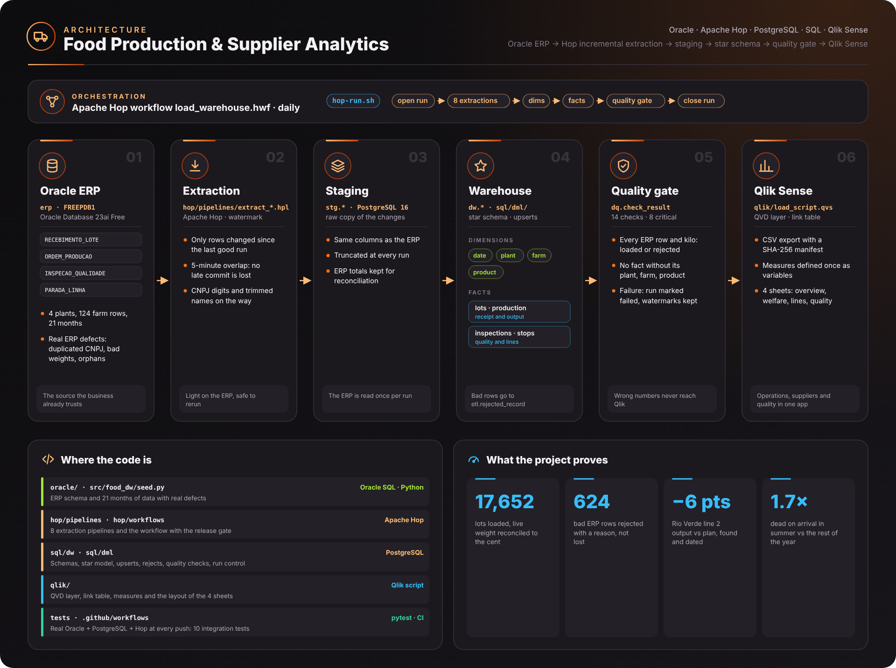
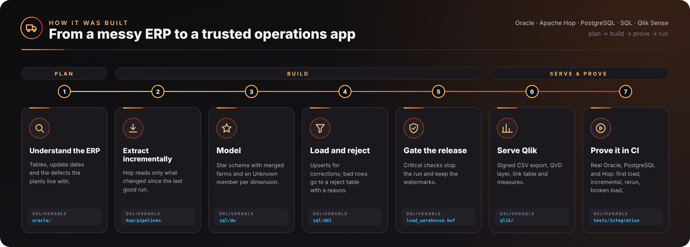
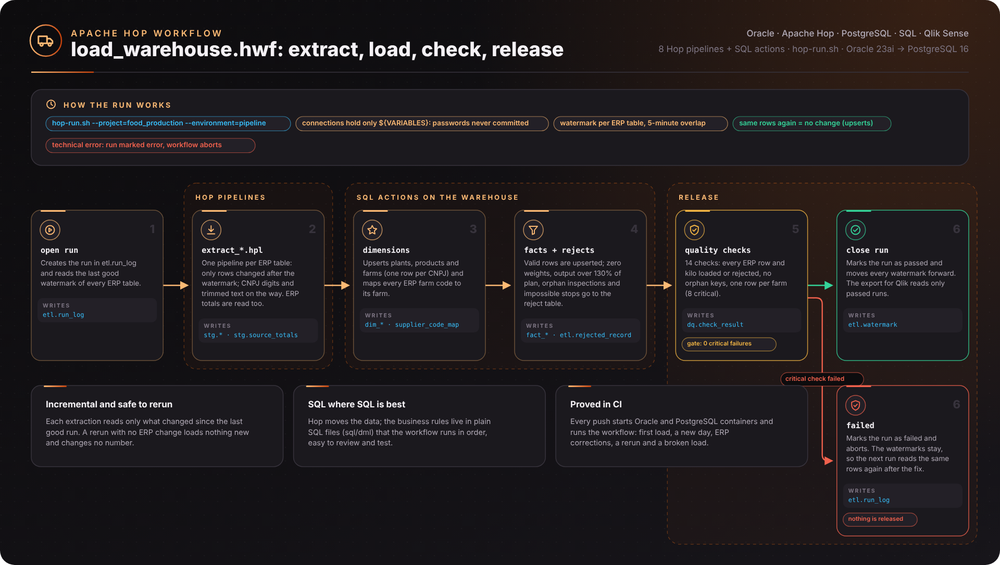
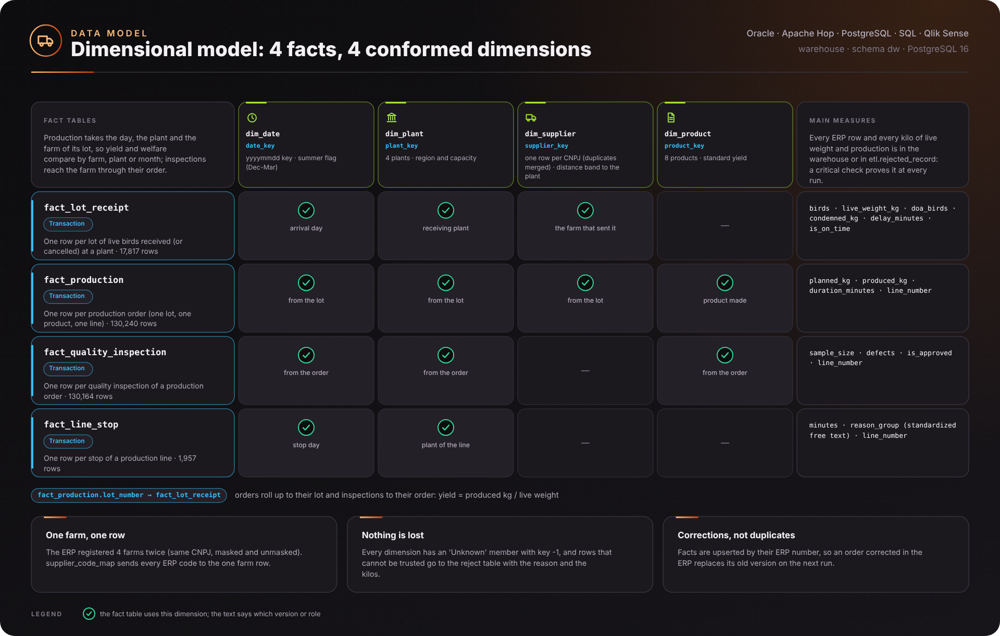

# Food Production & Supplier Analytics

[](https://github.com/vitorchavernue/food-production-supplier-analytics/actions/workflows/ci.yml)

Data warehouse and **Qlik Sense** app for a **poultry processing company** with four plants and 120 integrated farms:
from the **Oracle ERP** to a trusted view of supplier performance, animal welfare, plant output and quality.

- **Oracle Database** as the ERP source (receipts of live birds, production orders, quality inspections, line stops)
- **Apache Hop** (the open-source continuation of Pentaho Data Integration) extracting **incrementally by watermark**
- **PostgreSQL** data warehouse: staging, star schema with **4 facts and 4 conformed dimensions**, upserts, reject table
- **14 data quality checks**; the 8 critical ones are a **release gate** inside the Hop workflow
- **Qlik Sense** load script with a QVD layer, a **link table** and the measures as variables
- **CI on real databases:** every push starts Oracle and PostgreSQL containers and runs the Hop workflow end to end

---

## 🎯 Business problem

The plants run on the ERP, but every report is a spreadsheet built by hand from ERP extracts. The numbers do not match
between areas, and the questions that matter cannot be answered:

| Problem | Impact |
|---|---|
| Dead-on-arrival birds are counted, but nobody sees **which farms, routes and months** drive them | Animal welfare risk, condemned meat and audit findings from the buyers |
| Output and quality are followed per plant, not **per line and per month** | A degrading line is noticed only when the customer complains |
| The same farm is registered twice (CNPJ with and without punctuation) | Supplier rankings and bonuses are calculated on split numbers |
| Typing errors in the ERP (zero weights, production above 130% of plan, inspections of orders that do not exist) | Any KPI built directly on the ERP is wrong, and nobody knows by how much |
| Full ERP extracts every night | Slow, heavy on the production database, and a failed night means starting again |

## 💡 Solution

| Component | What was built | Problem solved |
|---|---|---|
| **Extraction** | 8 Hop pipelines read only the rows changed since the last good run (5-minute overlap), clean CNPJ and text on the way | Light on the ERP; a rerun reads the same changes again |
| **Staging** | `stg.*` tables in PostgreSQL, truncated every run, plus the ERP totals of the run | The ERP is read once; the totals are used to reconcile |
| **Star schema** | `dw.dim_date`, `dim_plant`, `dim_supplier` (one row per CNPJ), `dim_product`; facts for lots, production, inspections and line stops | One version of every number, comparable by farm, plant, line and month |
| **Rejects** | Rows that cannot be trusted go to `etl.rejected_record` with the reason and the kilos | Nothing disappears silently; the ERP team gets a list to fix |
| **Quality gate** | 14 checks in `dq.check_result`; a critical failure marks the run as failed and keeps the watermarks | Wrong numbers never reach Qlik |
| **Qlik Sense** | CSV export with a SHA-256 manifest, QVD layer, link table, measures defined once, 4 sheets | Operations, suppliers and quality in one app, same numbers as the warehouse |
| **CI** | Oracle 23ai Free + PostgreSQL 16 + Apache Hop in GitHub Actions: first load, incremental day, ERP corrections, rerun, broken load | Every change is proven on the real stack |

## 📈 Results — what the data shows

The ERP holds **21 months** of operation (January 2025 – September 2026): **17,652 received lots**, **361.8 million birds**
and **1,030,887 tonnes** of live weight. The numbers below come from the warehouse after the release gate passed.

| Finding | Evidence |
|---|---|
| **Heat stress drives mortality in transport** | Dead on arrival **0.300% in summer** (December to March) vs. **0.173%** the rest of the year: 1.7× |
| **Distance matters** | DOA grows from **0.170%** under 30 km to **0.319%** over 100 km |
| **Two farms need a welfare visit** | **Avícola Ouro Verde** (Rio Verde) **1.12%** and **Avícola Bela Vista** (Toledo) **0.50%**, against 0.215% overall |
| **Rio Verde line 2 is degrading since March 2026** | Output vs. plan fell from **98.5% to 92.5%**; stops went from 102 in 14 months to **154 in 7 months**; approval in inspections from 94.8% to **73.8%**, defect rate from 1.8% to **3.9%** |
| **The ERP has 624 rows that cannot be trusted** | 47 lots with zero or negative weight, 245 orders above 130% of plan, 321 inspections of orders that do not exist, 11 stops that end before they start |
| **One supplier ranking, not two** | 4 farms registered twice in the ERP are merged by CNPJ: 124 ERP rows → 120 farms |

**Recommended actions:** welfare visits and transport rules (night loading, density) for the two outlier farms and for
routes over 100 km in summer; maintenance inspection of Rio Verde line 2; return the reject list to the ERP owners
every morning.

---

## 🏗️ Architecture





<sub>Diagrams generated by [`scripts/build_architecture.py`](scripts/build_architecture.py) (SVG and PNG in `docs/images/`).</sub>

## 🔁 The Hop workflow



[`hop/workflows/load_warehouse.hwf`](hop/workflows/load_warehouse.hwf) opens the run, starts the 8 extraction pipelines
([`hop/pipelines`](hop/pipelines)), runs the SQL files in [`sql/dml`](sql/dml) (dimensions, facts and rejects, quality
checks) and evaluates the gate. The connections in [`hop/metadata/rdbms`](hop/metadata/rdbms) contain only variables
(`${ORA_HOST}`, `${DW_PASSWORD}`...): the values come from a Hop environment created at run time, so no password is
ever committed. Design decisions are in [`docs/adr`](docs/adr).

## 🧩 Data model



Two views in the `mart` schema (`supplier_monthly`, `plant_line_monthly`) answer the most common questions in SQL.

## 🧹 Data quality

| Issue in the ERP | Rule |
|---|---|
| Same farm registered twice (CNPJ with and without punctuation) | Digits-only CNPJ; one farm row; every ERP code mapped to it |
| Lot received with zero or negative weight or bird count | Rejected (reason + kilos) |
| Produced weight above 130% of plan, or not positive | Rejected |
| Inspection of a production order that does not exist | Rejected |
| Line stop that ends before it starts | Rejected |
| Stop reasons typed freely (`Manutenção corretiva`, `MANUTENCAO CORRETIVA`...) | Standardized into 6 reason groups (plus `Other`) |
| Cancelled lots | Kept with status `cancelled`, excluded from the weight and welfare measures |

Critical checks of every run: every ERP row and every kilo (lots and production) is in the warehouse or rejected; no
fact points to an unknown plant, farm or product; no farm has more than one row. A failure marks the run as **failed**,
keeps the watermarks and stops the workflow before anything is released.

## 📊 Qlik Sense

[`qlik/`](qlik) has the load script, the exported data and the layout of the 4 sheets (overview, animal welfare and
farms, plants and lines, data quality) with the expected values to check the app after the first reload.

---

## ▶️ Run it

Requires Python 3.11, Java 17, Docker, and Apache Hop 2.x
([download](https://hop.apache.org/download/)) with the Oracle JDBC driver (`ojdbc11.jar`) in `lib/jdbc`.

```bash
docker run -d -p 1521:1521 -e ORACLE_PASSWORD=<pw> -e APP_USER=erp -e APP_USER_PASSWORD=<pw> gvenzl/oracle-free:23-slim-faststart
docker run -d -p 5432:5432 -e POSTGRES_PASSWORD=<pw> postgres:16

pip install -r requirements.txt
export PYTHONPATH=src HOP_HOME=<hop folder> ORA_PASSWORD=<pw> DW_PASSWORD=<pw>
python -m food_dw demo     # warehouse + ERP history → full load → Qlik export → one more ERP day → incremental → rerun
```

Each step can also run alone: `python -m food_dw deploy | erp | run | export`. To open the workflow in the Hop GUI, add the
`hop/` folder as a project and create an environment with the variables listed in [`docs/runbook.md`](docs/runbook.md).

## 📁 Repository structure

```
├── oracle/                 # ERP schema (Oracle)
├── hop/
│   ├── pipelines/          # 8 extraction pipelines (.hpl)
│   ├── workflows/          # load_warehouse.hwf: the whole run with the release gate
│   └── metadata/           # connections (variables only) and run configurations
├── sql/
│   ├── dw/                 # schemas, staging, star schema, marts (PostgreSQL)
│   └── dml/                # run control, dimensions, facts and rejects, quality checks
├── src/food_dw/            # ERP data generator, deploy, Hop runner, Qlik export, CLI
├── qlik/                   # load script, exported CSV files with manifest, sheet layout
├── tests/                  # unit tests and the end-to-end pipeline tests
└── docs/                   # ADRs, runbook, diagrams
```

## 🛠️ Tech stack

**Oracle Database** · **Apache Hop** · **PostgreSQL** · **SQL** · **Qlik Sense** · **Python** · **Docker** · **GitHub Actions**

## 📄 Data

The ERP data is synthetic, generated by [`src/food_dw/seed.py`](src/food_dw/seed.py) with a fixed seed: realistic
volumes for four plants, seasonal patterns, two outlier farms, one degrading line and the typing errors found in real
ERPs. Company, farm and plant names are fictitious.

## 👤 Author

**Vitor Chavernue** — Senior Data Engineer & Data Analyst
[LinkedIn](https://www.linkedin.com/in/vitorchavernue/) · [GitHub](https://github.com/vitorchavernue)
